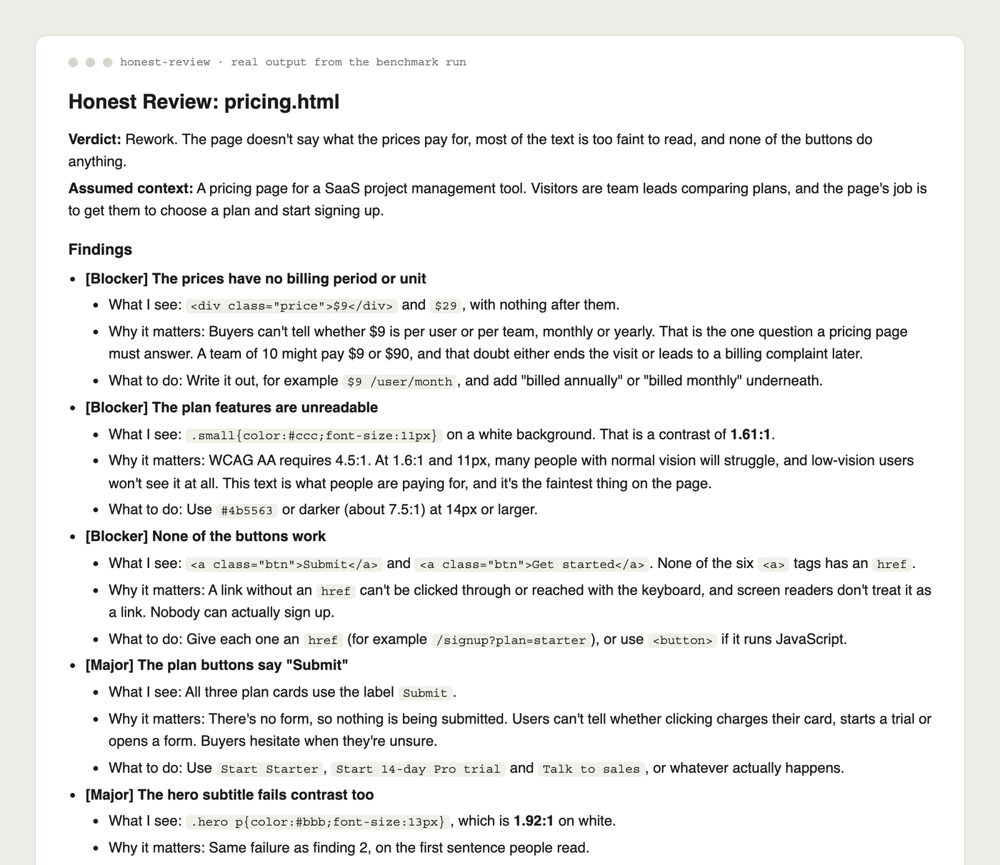
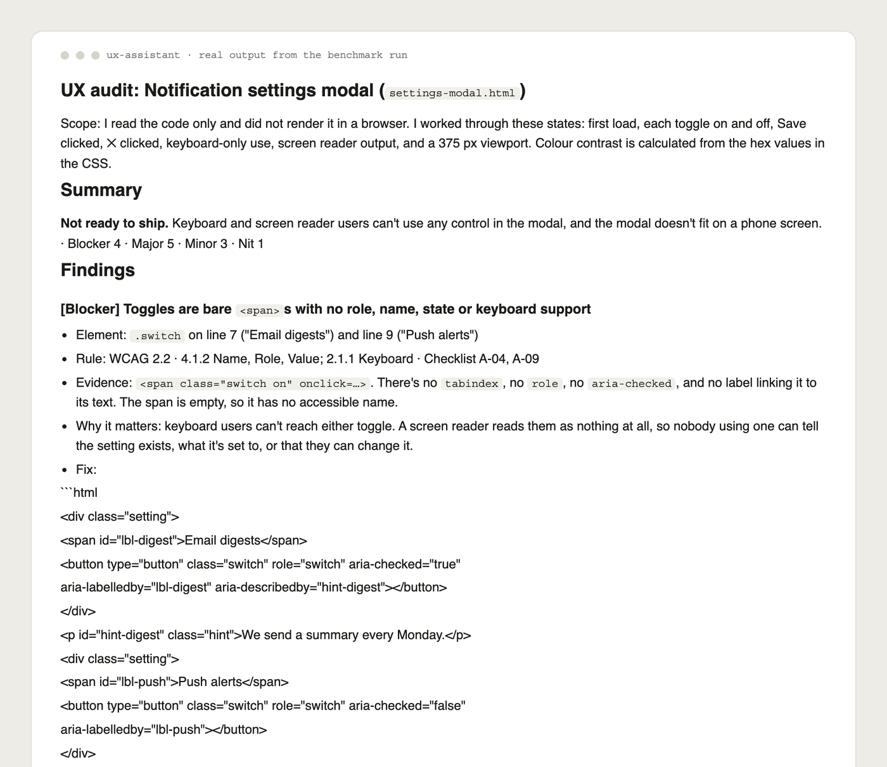
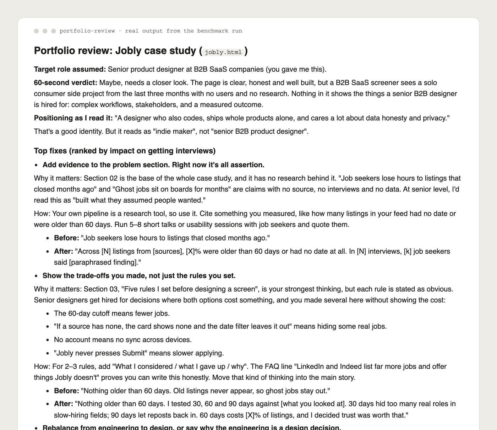
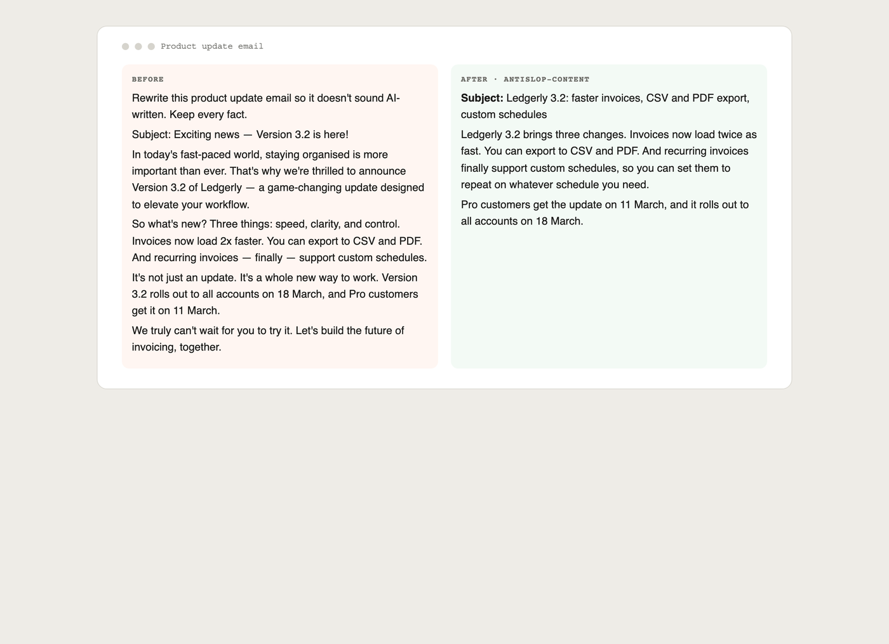
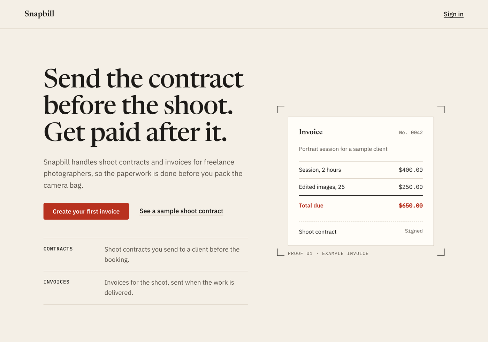
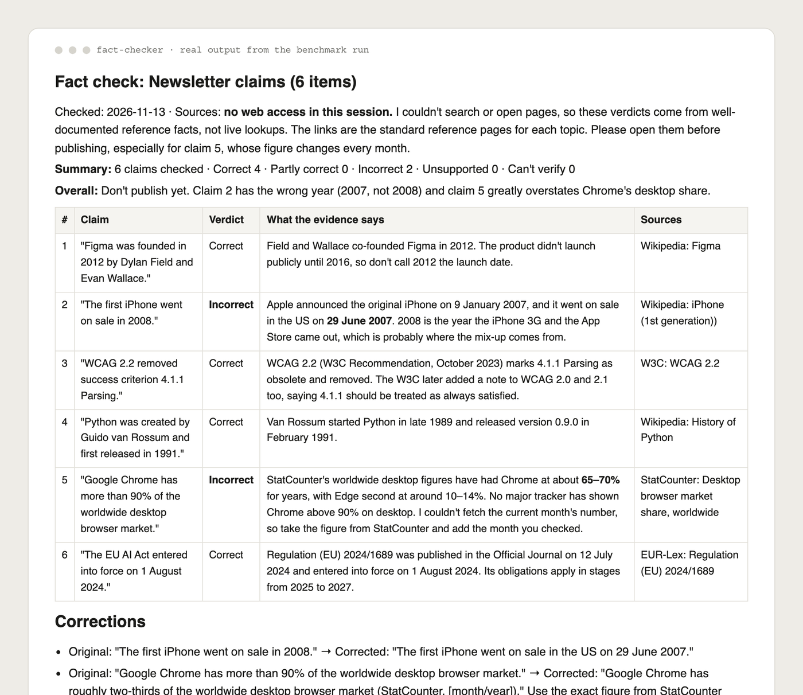
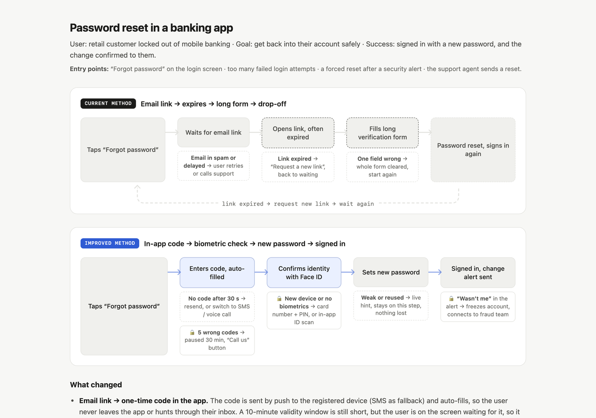
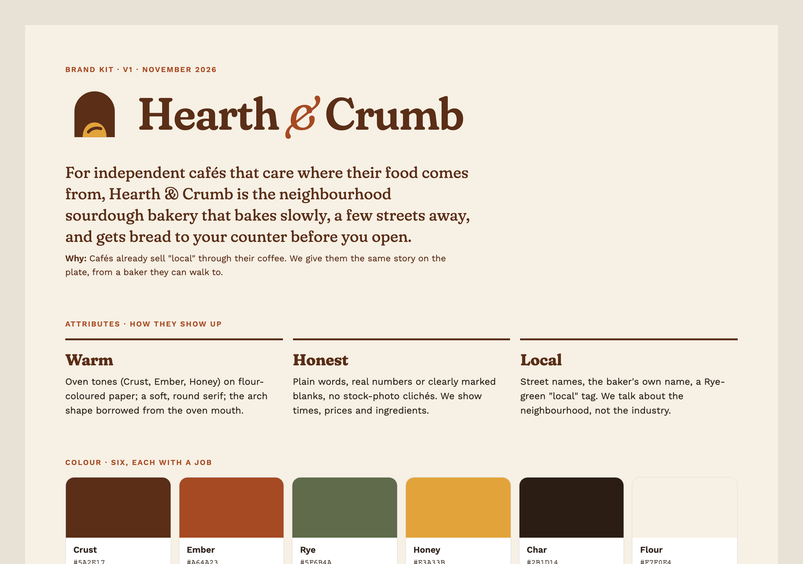

# Claude skills by Muzeeb Urrahaman

Eight Claude skills for design review, UX audits, portfolio feedback, writing, UI, fact-checking, user flows and brand kits. Each one is benchmarked against plain Claude and the closest comparable skill, and every screenshot below is real output from those test runs.

```bash
mkdir -p ~/.claude/skills && curl -fsSL https://github.com/MUZEEBURRAHAMAN/claude-skills/raw/main/dist/honest-review.zip -o /tmp/honest-review.zip && unzip -oq /tmp/honest-review.zip -d ~/.claude/skills/
```

Swap `honest-review` for any skill name below. On Claude.ai, download a zip from [`dist/`](dist) and upload it under Settings → Capabilities → Skills.

## What they make

<table><tr>
<td width="50%" valign="top"><a href="honest-review"></a><br><b><a href="honest-review">Honest Review</a></b><br>A design review that tells you what is wrong, ranked by how much it hurts.</td>
<td width="50%" valign="top"><a href="ux-assistant"></a><br><b><a href="ux-assistant">UX Assistant</a></b><br>A UX and accessibility audit with the WCAG rule, the measured value and the code fix.</td></tr><tr>
<td width="50%" valign="top"><a href="portfolio-review"></a><br><b><a href="portfolio-review">Portfolio Review</a></b><br>Reads your case study the way a hiring manager does in 60 seconds, then tells you what to fix.</td>
<td width="50%" valign="top"><a href="antislop-content"></a><br><b><a href="antislop-content">Antislop · Content</a></b><br>Strips the ChatGPT tells out of your writing and keeps every fact.</td></tr><tr>
<td width="50%" valign="top"><a href="antislop-ui"></a><br><b><a href="antislop-ui">Antislop · UI</a></b><br>Finds the defaults that make a page look AI-generated and rebuilds it around the product.</td>
<td width="50%" valign="top"><a href="fact-checker"></a><br><b><a href="fact-checker">Fact Checker</a></b><br>Checks a document claim by claim, with a source for every verdict.</td></tr><tr>
<td width="50%" valign="top"><a href="user-flow-creator"></a><br><b><a href="user-flow-creator">User Flow Creator</a></b><br>Turns a brief into clean pipeline flows, with the current and better way stacked.</td>
<td width="50%" valign="top"><a href="brandkit-deck"></a><br><b><a href="brandkit-deck">Brand Kit & Pitch Deck</a></b><br>Give it a logo and a theme. Get a brand kit and a 10-slide deck that match.</td></tr><tr>
</tr></table>

## Benchmark

Share of written checks passed across two test cases per skill.

| Skill | No skill | Comparable skill | v1.0 | Current |
|---|---|---|---|---|
| [Honest Review](honest-review) | 64% | design-critique: 68% | 100% | **v1.1: 100%** |
| [UX Assistant](ux-assistant) | 69% | accessibility-auditor: 77% | 100% | **v1.1: 100%** |
| [Portfolio Review](portfolio-review) | 75% | design-critique: 79% | 92% | **v1.1: 92%** |
| [Antislop · Content](antislop-content) | 75% | stop-slop: 92% | 92% | **v1.1: 92%** |
| [Antislop · UI](antislop-ui) | 70% | impeccable: 65% | 80% | **v1.2: 98%** |
| [Fact Checker](fact-checker) | 85% | deep-research: 85% | 92% | **v1.1: 98%** |
| [User Flow Creator](user-flow-creator) | 50% | ux-flow-designer: 11% | 42% | **v1.2: 88%** |
| [Brand Kit & Pitch Deck](brandkit-deck) | 64% | ui-ux-pro-max · brand: 86% | 86% | **v1.1: 86%** |

How it was run: `claude plugin eval` in clean sessions with no other skills installed, an independent model grading each run (three votes per check). The comparable skills often didn’t switch themselves on, which is part of why they score lower; each skill page says how often. Test cases and checks are in each skill’s `evals/` folder. Details: https://muzeeb-design.vercel.app/skills

## Acknowledgements

v1.2 of User Flow Creator and Antislop UI borrows rules from two MIT-licensed skill packs: flow rules from [super-ux](https://github.com/ssheleg/super-ux) by ssheleg, and the focal-accent, borders-not-shadows and self-check ideas from [diagram-design](https://github.com/cathrynlavery/diagram-design) by Cathryn Lavery.

## License

MIT
