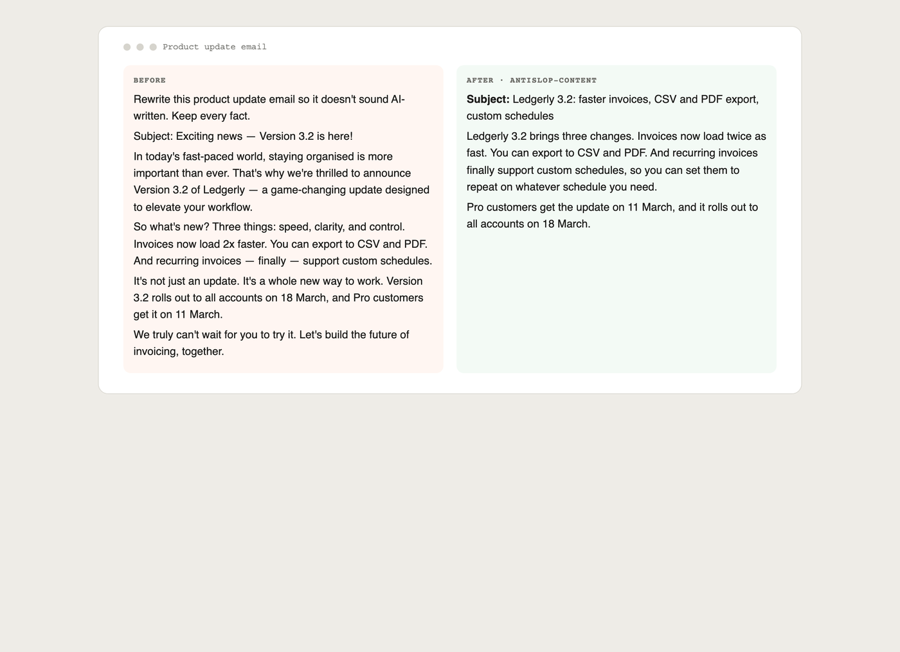

# Antislop · Content

**Strips the ChatGPT tells out of your writing and keeps every fact.**

```bash
mkdir -p ~/.claude/skills && curl -fsSL https://github.com/MUZEEBURRAHAMAN/claude-skills/raw/main/dist/antislop-content.zip -o /tmp/antislop-content.zip && unzip -oq /tmp/antislop-content.zip -d ~/.claude/skills/
```

Ask: *“Make this sound less like ChatGPT”*



*Before and after, from the benchmark: a product update email.*

## What it does

Rewrites posts, emails, docs and UI copy so they stop sounding machine-made. It cuts throat-clearing openers, fake depth, forced triplets and vague verbs, keeps every fact, scores the before and after, and lists each change.

**Who it’s for:** Anyone who drafts with AI: designers writing case studies, founders posting on LinkedIn, PMs writing specs.

## Benchmark

| Setup | Checks passed |
|---|---|
| No skill | 9/12 (75%) |
| stop-slop | 22/24 (92%) |
| Antislop · Content v1.0 | 11/12 (92%) |
| **Antislop · Content v1.1** | **22/24 (92%)** |

Two test cases, the same written checks for every setup. v1.1 passed 22 of 24 checks (92%), against 92% for v1.0, 92% for stop-slop and 75% with no skill.

Two test cases live in [`evals/`](evals). Each setup ran in a clean Claude Code session with no other skills installed, and an independent model graded every run against the same written checks. Full results: [https://muzeeb-design.vercel.app/skills/antislop-content](https://muzeeb-design.vercel.app/skills/antislop-content.html)

## What changed in v1.1

- New first step: a fact ledger listing every name, number, date and feature before editing.
- The rewrite is checked against the ledger, so nothing is lost and nothing new is added.

## Files

- [`SKILL.md`](SKILL.md): the skill itself
- [`evals/`](evals): test cases and checks, runnable with `claude plugin eval`
