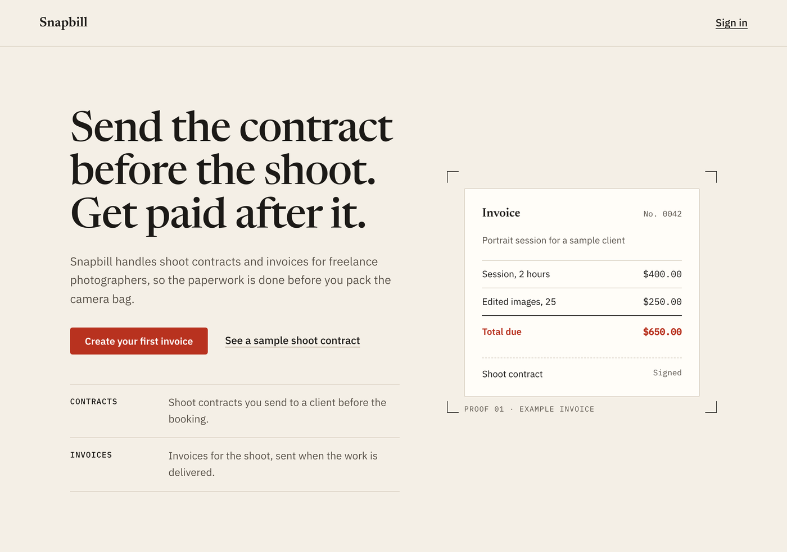

# Antislop · UI

**Finds the defaults that make a page look AI-generated and rebuilds it around the product.**

```bash
mkdir -p ~/.claude/skills && curl -fsSL https://github.com/MUZEEBURRAHAMAN/claude-skills/raw/main/dist/antislop-ui.zip -o /tmp/antislop-ui.zip && unzip -oq /tmp/antislop-ui.zip -d ~/.claude/skills/
```

Ask: *“This page looks AI-generated, fix it”*




*Before (the test page) and after (the skill’s rebuild), from the benchmark.*

## What it does

Reviews a page or component for the tells of AI-generated UI: purple gradients, gradient text, emoji cards, glow buttons, fake stats, Inter everywhere. It scores how generic the page is, lists each tell with where it is, and rebuilds the page with tokens and a product-specific idea.

**Who it’s for:** Developers shipping AI-generated front ends, designers reviewing vibe-coded prototypes, and founders whose landing page looks like everyone else's.

## Benchmark

| Setup | Checks passed |
|---|---|
| No skill | 14/20 (70%) |
| impeccable | 13/20 (65%) |
| Antislop · UI v1.0 | 16/20 (80%) |
| **Antislop · UI v1.2** | **39/40 (98%)** |

Two test cases, the same written checks for every setup. v1.2 passed 39 of 40 checks (98%), against 80% for v1.0, 65% for impeccable and 70% with no skill.

Two test cases live in [`evals/`](evals). Each setup ran in a clean Claude Code session with no other skills installed, and an independent model graded every run against the same written checks. Full results: [https://muzeeb-design.vercel.app/skills/antislop-ui](https://muzeeb-design.vercel.app/skills/antislop-ui.html)

## What changed in v1.2

- Reads the footer and meta tags first, where the real product is often described.
- Five tells it now checks for by name, including placeholder logo walls and glassmorphism.
- Always returns working code, not only advice.
- Proof stays real: it never writes replacement testimonials, logos or user counts.
- States contrast ratios for the new palette, and avoids rebuilding the grid as three identical shadowed cards (borrowed from diagram-design).

## Files

- [`SKILL.md`](SKILL.md): the skill itself
- [`evals/`](evals): test cases and checks, runnable with `claude plugin eval`
