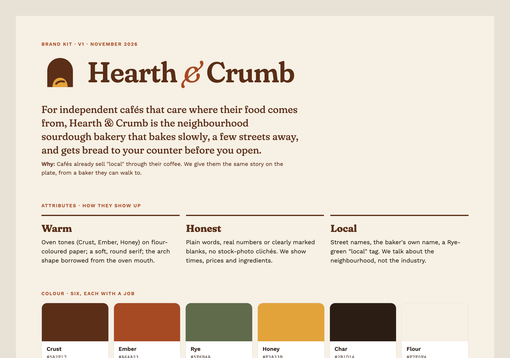

# Brand Kit & Pitch Deck

**Give it a logo and a theme. Get a brand kit and a 10-slide deck that match.**

```bash
mkdir -p ~/.claude/skills && curl -fsSL https://github.com/MUZEEBURRAHAMAN/claude-skills/raw/main/dist/brandkit-deck.zip -o /tmp/brandkit-deck.zip && unzip -oq /tmp/brandkit-deck.zip -d ~/.claude/skills/
```

Ask: *“Make a brand kit from this logo”*



*A real brand kit from the benchmark: Hearth & Crumb, a sourdough bakery.*

## What it does

Builds a brand kit from a logo and theme (or a short brief): positioning, a colour system with contrast ratios, a type pairing, logo rules and mockups. Then it builds a 10-slide investor or sales deck from the same tokens, as one HTML file. It never invents traction.

**Who it’s for:** Founders starting a company, designers kicking off a brand project, and teams launching a sub-brand.

## Benchmark

| Setup | Checks passed |
|---|---|
| No skill | 9/14 (64%) |
| ui-ux-pro-max · brand | 12/14 (86%) |
| Brand Kit & Pitch Deck v1.0 | 12/14 (86%) |
| **Brand Kit & Pitch Deck v1.1** | **24/28 (86%)** |

Two test cases, the same written checks for every setup. v1.1 passed 24 of 28 checks (86%), against 86% for v1.0, 86% for ui-ux-pro-max · brand and 64% with no skill.

Two test cases live in [`evals/`](evals). Each setup ran in a clean Claude Code session with no other skills installed, and an independent model graded every run against the same written checks. Full results: [https://muzeeb-design.vercel.app/skills/brandkit-deck](https://muzeeb-design.vercel.app/skills/brandkit-deck.html)

## What changed in v1.1

- The deck outline adapts to the audience: buyers get pricing, delivery and samples instead of market size.
- A final check counts exactly ten slides, contrast marks and placeholders.

## Files

- [`SKILL.md`](SKILL.md): the skill itself
- [`evals/`](evals): test cases and checks, runnable with `claude plugin eval`
