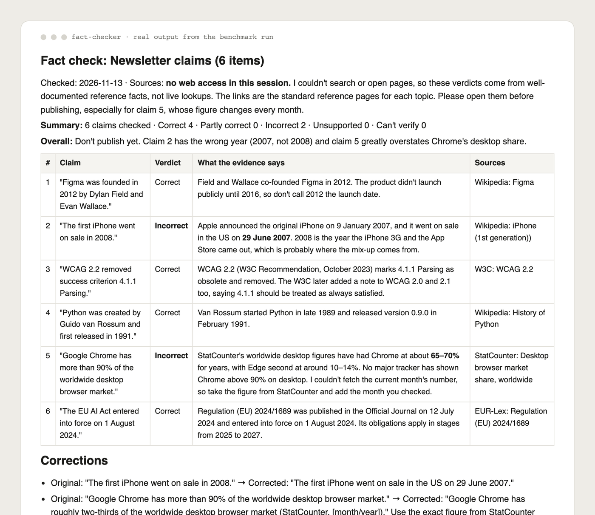

# Fact Checker

**Checks a document claim by claim, with a source for every verdict.**

```bash
mkdir -p ~/.claude/skills && curl -fsSL https://github.com/MUZEEBURRAHAMAN/claude-skills/raw/main/dist/fact-checker.zip -o /tmp/fact-checker.zip && unzip -oq /tmp/fact-checker.zip -d ~/.claude/skills/
```

Ask: *“Fact-check this”*



*A real fact check from the benchmark: six tech claims.*

## What it does

Upload a document or paste text. It pulls out every checkable claim, checks each against primary sources, and returns a verdict (correct, partly correct, incorrect, unsupported, can't verify) with the source and a corrected version. It never invents a link.

**Who it’s for:** Writers, marketers and researchers checking facts before publishing, and anyone asking “is this actually true?”.

## Benchmark

| Setup | Checks passed |
|---|---|
| No skill | 11/13 (85%) |
| deep-research | 22/26 (85%) |
| Fact Checker v1.0 | 12/13 (92%) |
| **Fact Checker v1.1** | **51/52 (98%)** |

Two test cases, the same written checks for every setup. v1.1 passed 51 of 52 checks (98%), against 92% for v1.0, 85% for deep-research and 85% with no skill. deep-research only switched itself on in 0 of 4 runs.

Two test cases live in [`evals/`](evals). Each setup ran in a clean Claude Code session with no other skills installed, and an independent model graded every run against the same written checks. Full results: [https://muzeeb-design.vercel.app/skills/fact-checker](https://muzeeb-design.vercel.app/skills/fact-checker.html)

## What changed in v1.1

- Every row needs a source the reader can open.
- Wrong claims must state the right value; superlatives and big numbers get the real figure and date.
- Claims that were true and later changed are reported with both dates.

## Files

- [`SKILL.md`](SKILL.md): the skill itself
- [`evals/`](evals): test cases and checks, runnable with `claude plugin eval`
