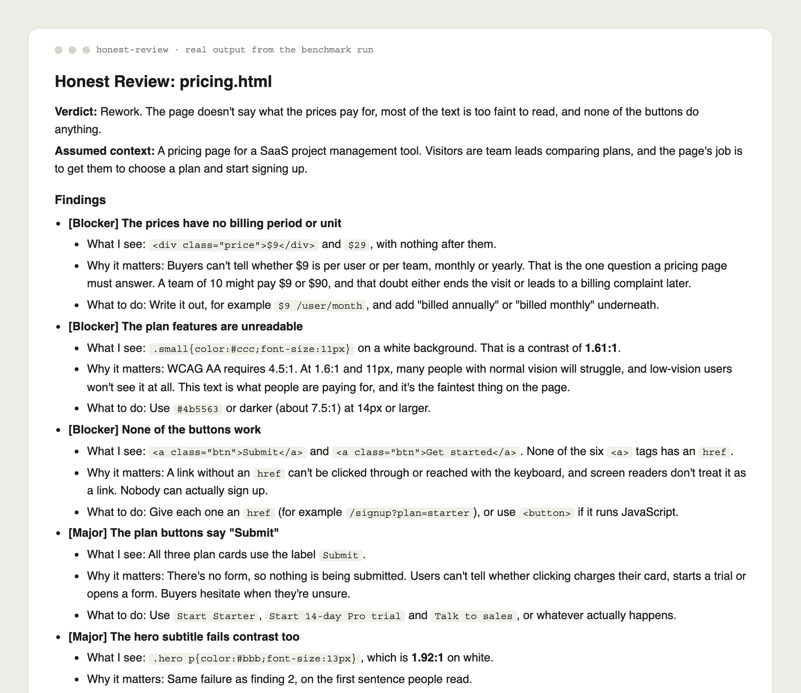

# Honest Review

**A design review that tells you what is wrong, ranked by how much it hurts.**

```bash
mkdir -p ~/.claude/skills && curl -fsSL https://github.com/MUZEEBURRAHAMAN/claude-skills/raw/main/dist/honest-review.zip -o /tmp/honest-review.zip && unzip -oq /tmp/honest-review.zip -d ~/.claude/skills/
```

Ask: *“Be brutally honest about this page”*



*A real review from the benchmark: the pricing-page test case.*

## What it does

Reviews a screen, page, flow or Figma frame like a senior design lead who has no reason to be polite. You get a verdict first, then findings ranked Blocker to Nit, each with what it sees, why it matters and the fix.

**Who it’s for:** Designers who want blunt feedback before a crit, founders checking a page before launch, and developers who built UI without a designer.

## Benchmark

| Setup | Checks passed |
|---|---|
| No skill | 9/14 (64%) |
| design-critique | 19/28 (68%) |
| Honest Review v1.0 | 14/14 (100%) |
| **Honest Review v1.1** | **56/56 (100%)** |

Two test cases, the same written checks for every setup. v1.1 passed 56 of 56 checks (100%), against 100% for v1.0, 68% for design-critique and 64% with no skill. design-critique only switched itself on in 2 of 4 runs.

Two test cases live in [`evals/`](evals). Each setup ran in a clean Claude Code session with no other skills installed, and an independent model graded every run against the same written checks. Full results: [https://muzeeb-design.vercel.app/skills/honest-review](https://muzeeb-design.vercel.app/skills/honest-review.html)

## What changed in v1.1

- The verdict must start with one of three fixed labels: Ship, Ship after fixes or Rework.
- Every finding needs all three labelled parts, with quoted evidence from the file.
- Contrast is measured from the real colours and reported as a ratio.
- The score block is always the last thing in the review, and em dashes are banned.

## Files

- [`SKILL.md`](SKILL.md): the skill itself
- [`evals/`](evals): test cases and checks, runnable with `claude plugin eval`
