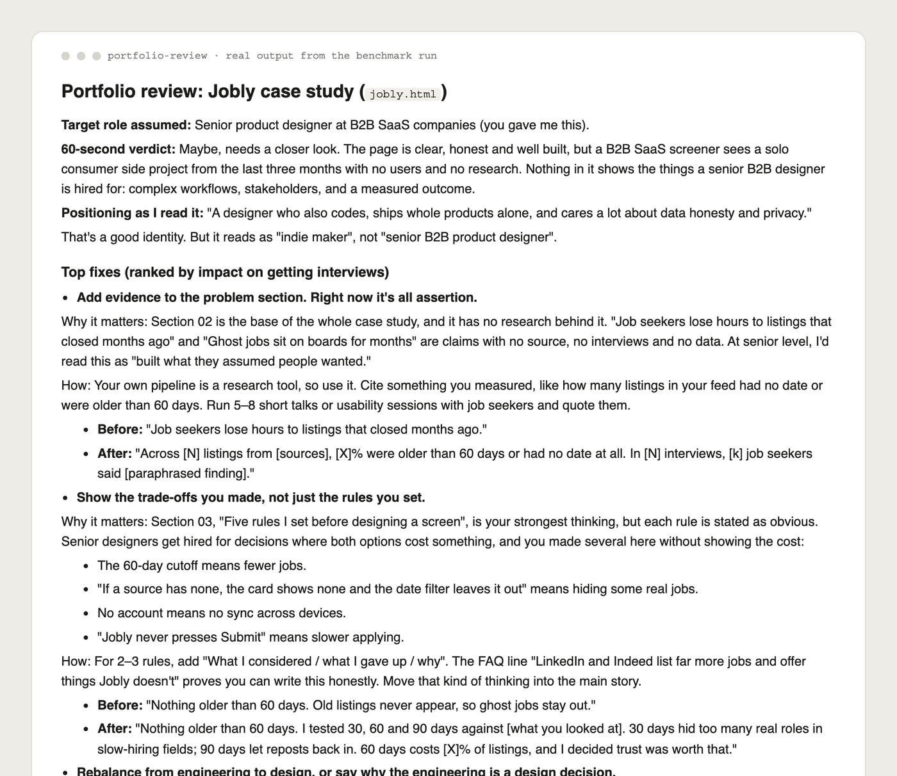

# Portfolio Review

**Reads your case study the way a hiring manager does in 60 seconds, then tells you what to fix.**

```bash
mkdir -p ~/.claude/skills && curl -fsSL https://github.com/MUZEEBURRAHAMAN/claude-skills/raw/main/dist/portfolio-review.zip -o /tmp/portfolio-review.zip && unzip -oq /tmp/portfolio-review.zip -d ~/.claude/skills/
```

Ask: *“Review my portfolio”*



*A real review from the benchmark: my own Jobly case study.*

## What it does

Reviews a design portfolio or case study for a specific role. You get the 60-second verdict a hiring manager would reach, a score, the fixes ranked by how much they change your chances, and example rewrites.

**Who it’s for:** Designers applying for jobs, juniors building a first portfolio, and seniors moving into a new industry.

## Benchmark

| Setup | Checks passed |
|---|---|
| No skill | 9/12 (75%) |
| design-critique | 19/24 (79%) |
| Portfolio Review v1.0 | 11/12 (92%) |
| **Portfolio Review v1.1** | **22/24 (92%)** |

Two test cases, the same written checks for every setup. v1.1 passed 22 of 24 checks (92%), against 92% for v1.0, 79% for design-critique and 75% with no skill. design-critique only switched itself on in 0 of 4 runs.

Two test cases live in [`evals/`](evals). Each setup ran in a clean Claude Code session with no other skills installed, and an independent model graded every run against the same written checks. Full results: [https://muzeeb-design.vercel.app/skills/portfolio-review](https://muzeeb-design.vercel.app/skills/portfolio-review.html)

## What changed in v1.1

- Names five red flags by name: hidden ownership, no problem statement, process theatre, unbacked outcomes, role mismatch.
- Every rewrite is shown as Before and After, with numbers left as placeholders.
- Verdict, positioning, three fixes and the scorecard are now required, even for short case studies.

## Files

- [`SKILL.md`](SKILL.md): the skill itself
- [`evals/`](evals): test cases and checks, runnable with `claude plugin eval`
