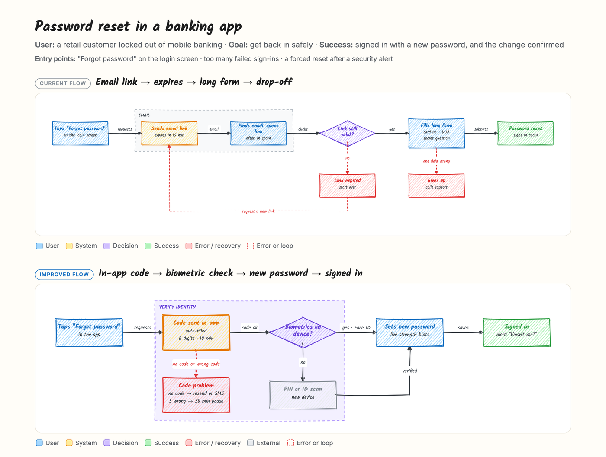

# User Flow Creator

**Turns a brief into clean pipeline flows, with the current and better way stacked.**

```bash
mkdir -p ~/.claude/skills && curl -fsSL https://github.com/MUZEEBURRAHAMAN/claude-skills/raw/main/dist/user-flow-creator.zip -o /tmp/user-flow-creator.zip && unzip -oq /tmp/user-flow-creator.zip -d ~/.claude/skills/
```

Ask: *“Create a user flow for this”*



*Password reset in a banking app, drawn with the v1.3 canvas. [Open the HTML](../docs/examples/password-reset-flow.html).*

## What it does

Designs user flows and draws them as calm HTML pipelines: a label, a title that states the outcome, stages joined by connectors, return loops and error branches. It can stack the current flow over a proposed one, then adds a step table and open questions.

**Who it’s for:** Product designers mapping a feature, PMs explaining a process to stakeholders, and founders sketching how their product works.

## Benchmark

| Setup | Checks passed |
|---|---|
| No skill | 6/12 (50%) |
| ux-flow-designer | 2/18 (11%) |
| User Flow Creator v1.0 | 5/12 (42%) |
| **User Flow Creator v1.2** | **21/24 (88%)** |

Two test cases, the same written checks for every setup. v1.2 passed 21 of 24 checks (88%), against 42% for v1.0, 11% for ux-flow-designer and 50% with no skill.

Two test cases live in [`evals/`](evals). Each setup ran in a clean Claude Code session with no other skills installed, and an independent model graded every run against the same written checks. Full results: [https://muzeeb-design.vercel.app/skills/user-flow-creator](https://muzeeb-design.vercel.app/skills/user-flow-creator.html)

## What changed in v1.3

- Flows are drawn on an Excalidraw-style canvas: hand-drawn boxes coloured by role, dashed zones, diamond decisions, labelled arrows, and red dashed error and loop paths. See the [full example](../docs/examples/password-reset-flow.html).
- The benchmark above is from v1.2; v1.3 changes the drawing, not the checks it was graded on, and hasn't been re-run yet.

## What changed in v1.2

- A ‘What changed’ list explains every removed or automated step.
- Flows in money, health or identity products must show safeguards as stages.
- Every flow lists its failure paths: lost messages, expired links, drop-offs, outages.
- When it can't save a file, it pastes the complete HTML instead of a text outline, so the diagrams, table and edge cases survive. (The test sessions block file writing for every setup, which is why no setup passes ‘An HTML file is produced’.)
- Flow rules borrowed from super-ux: every decision is a branch, every error lands on recovery, entry points listed, happy path of five stages or fewer.
- A self-check list runs before the flow is handed over.

## Files

- [`SKILL.md`](SKILL.md): the skill itself
- [`evals/`](evals): test cases and checks, runnable with `claude plugin eval`
