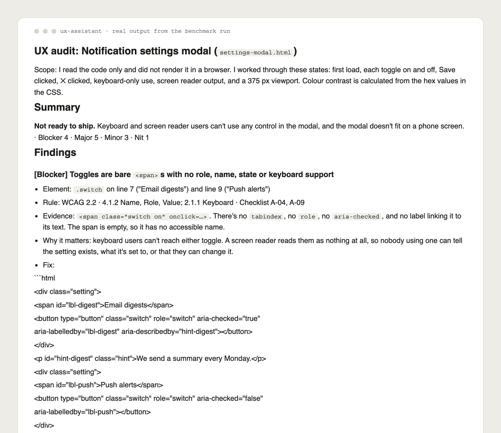

# UX Assistant

**A UX and accessibility audit with the WCAG rule, the measured value and the code fix.**

```bash
mkdir -p ~/.claude/skills && curl -fsSL https://github.com/MUZEEBURRAHAMAN/claude-skills/raw/main/dist/ux-assistant.zip -o /tmp/ux-assistant.zip && unzip -oq /tmp/ux-assistant.zip -d ~/.claude/skills/
```

Ask: *“Audit this form for UX and accessibility”*



*A real audit from the benchmark: the settings-modal test case.*

## What it does

Audits a screen, component or flow against usability heuristics and WCAG 2.2 AA. It works through every state (empty, error, focus, loading, 375px, 200% zoom) and returns findings by severity, each tied to a rule, a measurement and a fix you can paste.

**Who it’s for:** Product designers handing off to engineering, engineers fixing accessibility bugs, and teams preparing for an accessibility review.

## Benchmark

| Setup | Checks passed |
|---|---|
| No skill | 9/13 (69%) |
| accessibility-auditor | 20/26 (77%) |
| UX Assistant v1.0 | 13/13 (100%) |
| **UX Assistant v1.1** | **26/26 (100%)** |

Two test cases, the same written checks for every setup. v1.1 passed 26 of 26 checks (100%), against 100% for v1.0, 77% for accessibility-auditor and 69% with no skill.

Two test cases live in [`evals/`](evals). Each setup ran in a clean Claude Code session with no other skills installed, and an independent model graded every run against the same written checks. Full results: [https://muzeeb-design.vercel.app/skills/ux-assistant](https://muzeeb-design.vercel.app/skills/ux-assistant.html)

## What changed in v1.1

- New step: check every custom control (div buttons, CSS switches, icon buttons, modals, toasts) against its native equivalent.
- Exact contrast formula, so ratios are computed, not estimated.
- A pass/fail checklist for the report: WCAG numbers, selectors, a numeric ratio and the states checked.

## Files

- [`SKILL.md`](SKILL.md): the skill itself
- [`evals/`](evals): test cases and checks, runnable with `claude plugin eval`
